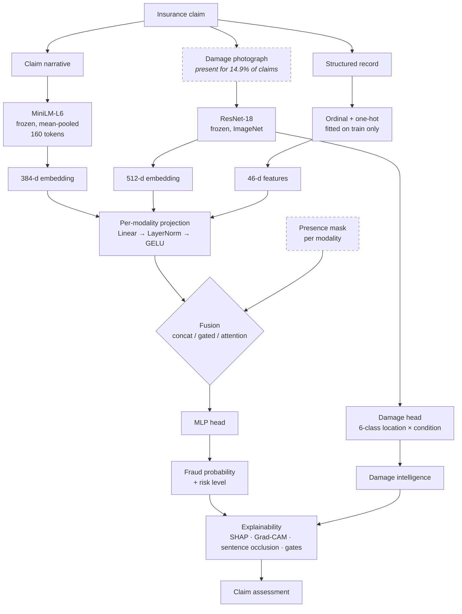

# Multimodal Insurance Fraud Detection & Damage Intelligence

Does combining claim narratives, damage photographs and structured policy
records improve fraud detection over any single source?

On the data available, **no** — and this repository is built to show that
credibly rather than to argue otherwise. Every number below was produced by
running the pipeline; nothing is quoted from a paper or a dataset card.

[](https://github.com/koushiksoppa/multimodal-insurance-fraud-detection/actions/workflows/ci.yml)

---

## Contents

- [Overview](#overview) · [Motivation](#motivation) · [Research question](#research-question)
- [Architecture](#architecture) · [Dataset](#dataset) · [Methodology](#methodology)
- [Results](#results) · [Ablation study](#ablation-study) · [Calibration](#calibration)
- [Explainability](#explainability) · [Damage intelligence](#damage-intelligence)
- [Installation](#installation) · [Reproducing the results](#reproducing-the-results) · [Testing](#testing)
- [Limitations](#limitations) · [Responsible AI](#responsible-ai) · [Project status](#project-status) · [Future work](#future-work)

---

## Overview

An insurance claim arrives as several kinds of evidence at once: a structured
policy record, a free-text description of what happened, and often a set of
damage photographs. Each is handled by a different part of an insurer's
operation, and each is usually modelled separately.

This project builds a system that consumes all three, fuses them, and produces
a model-indicated fraud risk score together with an auxiliary damage
assessment and per-modality explanations. It then tries honestly to find out
whether the fusion was worth doing.

The headline finding is negative, and the design is what makes that finding
trustworthy:

| Finding | Evidence |
|---|---|
| **The image modality contributes nothing** to fraud detection here | ROC-AUC 0.5053 ± 0.0076 alone — chance. This was *predicted by construction* and serves as a negative control. |
| **Text adds ranking quality that is not separable from noise** | Best multimodal ROC-AUC 0.6880 ± 0.0323 vs 0.6578 ± 0.0021 for structured alone: a ~2-point gap inside one standard deviation. |
| **On PR-AUC, the metric that matters at a 5% base rate, fusion makes things worse** | Structured alone is the single best cell at 0.1044 ± 0.0019; every multimodal combination scores lower. |
| **Frozen sentence embeddings recover little from prose** | The text arm reaches 0.5237 ROC-AUC; the same facts as columns reach 0.6755. |
| **An uninformative modality actively costs you** | Gated fusion diverts 14.3% of its attention to the photograph when one exists, cannibalising text weight (0.396 → 0.237), and tri-modal PR-AUC falls below bimodal. |

## Motivation

Multimodal results are easy to fake without intending to. Three failure modes
recur:

1. **Re-encoding.** If the "text" is generated from the same fields as the
   "tabular" features, combining them cannot add information, but the
   combination will still often score higher through sheer extra capacity.
2. **Leakage.** If the same photograph, claim or customer appears on both sides
   of a split, every modality looks informative.
3. **No null hypothesis.** Without a modality known to be uninformative, there
   is no way to tell a real gain from a model that improves whenever you hand
   it more numbers.

This project is organised around not doing those three things. The channel
partition addresses the first, structural split disjointness the second, and
the negative-control design the third.

## Research question

**Primary hypothesis.** Combining complementary claim modalities improves
fraud/risk classification compared with single-modality models.

**Status: not supported on this data.** Reported as measured — see
[Results](#results).

Secondary questions, and where each is answered:

| Question | Answer | Where |
|---|---|---|
| How much does each modality contribute? | Structured dominates; text is marginal; image is nil | [Ablation](#ablation-study) |
| Does text carry useful fraud signal? | Some — ROC-AUC 0.524 vs 0.500 chance — but far below its own ceiling | [Ablation](#ablation-study) |
| Does image information help? | No. By construction it cannot, and the models agree | [Negative control](#the-negative-control) |
| Does structured data stay useful after adding deep features? | Yes; it remains the strongest single source | [Ablation](#ablation-study) |
| Which fusion strategy performs best? | Gated on ROC-AUC and calibration; none beats structured alone on PR-AUC | [Fusion strategies](#fusion-strategies) |
| Where does the multimodal model fail? | Implemented, not yet run | [Project status](#project-status) |

## Architecture



Two things in that diagram are load-bearing rather than decorative.

**The presence mask.** Every forward pass carries one bit per modality. An
absent modality is zeroed *after* projection, so it cannot leak through a bias
term, and gated and attention fusion renormalise over the modalities that are
actually present. This is not an afterthought for a missing-data edge case — it
is the normal path, because 85% of real claims have no photograph. Tests
confirm that perturbing a masked modality by a factor of 100 moves the output
by exactly zero under all three strategies.

**One architecture for every ablation cell.** The single-modality baselines are
the same network with fewer inputs, not different model families. Otherwise a
difference between cells would confound modality with architecture.

## Dataset

Full provenance, licence terms and measured statistics: **[docs/DATASETS.md](docs/DATASETS.md)**.

No public dataset pairs a fraud-labelled claim with its own photograph and its
own narrative. The corpus is therefore assembled, and the assembly is where
credibility is won or lost:

| Modality | Status | Real | Constructed |
|---|---|---|---|
| Structured | **Real** | 15,420 claims, 33 attributes, real fraud labels, real imbalance | nothing |
| Image | **Real** | 2,300 photographs, real human-assigned damage labels | the *attachment* to a claim |
| Text | **Constructed** | every asserted fact is a real value from the claim record | the prose expressing it |
| Fraud label | **Real** | `FraudFound_P` as distributed | nothing |

### Measured properties

| | |
|---|---:|
| Claims | 15,420 |
| Fraud positives | 923 (**5.986%**) |
| Imbalance ratio | 15.7 : 1 |
| Years covered | 1994–1996 |
| Duplicate feature vectors | 0 |
| Photographs | 2,300 (0 corrupt) |
| Claims with a photograph | 2,300 (**14.92%**) |
| Narrative length | median 79 words / 95 WordPiece tokens |
| Truncation at 160 tokens | **0.00%** (max observed 138) |
| Feature widths | tabular 46 · text 384 · image 512 |

Fraud rate declines across the three years — 6.659% → 5.794% → 5.217% — which
is why the headline protocol is a **temporal split**, not a random one.

| Split | Period | Claims | Fraud | Rate | With photo | Fraud + photo |
|---|---|---:|---:|---:|---:|---:|
| train | < 1995-07 | 8,762 | 550 | 6.28% | 1,313 | 81 |
| val | 1995-07 → 12 | 2,575 | 160 | 6.21% | 402 | 25 |
| test | 1996 | 4,083 | 213 | 5.22% | 585 | 32 |

### Data quality findings

Defects found in the *source* data by `src/data/quality.py`. All are reported,
none silently repaired:

- **320 rows code a missing driver age as `0`** — every one carries
  `AgeOfPolicyHolder = "16 to 17"`. Converted to explicit missingness plus a
  `driver_age_missing` indicator, so the model can use the fact of absence
  without being told the driver is a newborn.
- **`PolicyType` disagrees with `VehicleCategory` in 32.3% of rows** — 4,987
  records are `"Sedan - Liability"` with `VehicleCategory = Sport`. This matters
  because `PolicyType` is the most fraud-associated column in the table
  (Cramér's V = 0.168), so a model leaning on it leans on a field with a known
  encoding defect. Exposed as the engineered feature
  `policy_type_vehicle_mismatch`.
- **`PolicyNumber` is a monotonic row index**, not a customer key. Declared an
  identifier, never a feature — under a temporal split it is a direct proxy for
  time. A test enforces that identifiers stay out of the feature set.
- One malformed `MonthClaimed`; three negative implied report delays; four
  manufacturer names misspelled in the source (`Accura`, `Mecedes`, `Nisson`,
  `Porche`).

## Methodology

### The channel partition

The most important design decision, and the one most worth challenging.

If narratives were generated from *all* the structured fields, the text
modality would be a lossy re-encoding of the tabular one, and any "multimodal
gain" would be an artefact. So the 30 real feature columns are split into two
**disjoint** channels:

- **Tabular (15 fields)** — policy and vehicle attributes: the structured facts
  an insurer holds regardless of how the incident was described.
- **Narrative (15 fields)** — circumstantial detail a person writes in a
  report: fault, accident area, police report, witness, prior claims, address
  change, reporting delay.

**The rule is "what kind of information is this?", not "how predictive is
this?"** The partition was committed in `1af4334`, which predates any
measurement of per-feature association — verifiable in the git history, and
what stops the split from being quietly tuned to flatter one modality.

Measured afterwards, both channels carry real signal and the tabular one
carries more:

| Channel | Strongest field | Max Cramér's V | Mean |
|---|---|---:|---:|
| Tabular | `policy_type` | 0.168 | 0.063 |
| Narrative | `fault` | 0.131 | 0.038 |

`assert_disjoint_channels()` enforces this at build time and in the test suite.

### The negative control

Photographs and claim records come from different sources, so attachment must
be constructed. The rule is **label-independent, prevalence-preserving, and
reuses no photograph**: measured prevalence is 5.986% overall against 6.000% in
the image-covered subset.

Three consequences, stated plainly:

1. The photograph is **not of that claim's vehicle**. It carries real damage
   labels but no information about whether *that* claim was fraudulent.
2. The image arm is therefore a **negative control**. A correct system should
   extract no fraud signal from it. If it appeared to, that would indicate a
   leak or a bug — and the ablation table is where it would surface.
3. Because each photograph is used once and claims are disjoint across splits,
   **no image can appear on both sides of a split by construction** — a
   stronger guarantee than any after-the-fact duplicate check.

### Leakage controls

| Route | Control | Status |
|---|---|---|
| Same claim in two splits | splits partition claims | ✅ checked |
| Same image in two splits | each image attached to exactly one claim | ✅ checked |
| Same policy in two splits | policy number unique per row | ✅ checked |
| Duplicate records across splits | exact feature-vector comparison | ✅ checked |
| Future data in training | temporal ordering assertion | ✅ checked |
| Preprocessing fitted on test | scalers/encoders fitted inside an sklearn pipeline on train only | structural |
| Threshold tuned on test | thresholds selected on validation; the harness accepts no test threshold | structural |
| Augmentation leakage | applied to the training split only, inside the loop | structural |

All pass on `real-v1`. The build refuses to write a dataset that fails any.

### Models

| Component | Choice | Why |
|---|---|---|
| Structured | Logistic regression · random forest · LightGBM | spans a real trade-off; the linear model is the reference point |
| Text | **MiniLM-L6**, frozen, mean-pooled | encodes the corpus in 8.7 min on 4 CPU cores; BERT-base would take ~1 h for embeddings a 79-word narrative does not need |
| Image | **ResNet-18**, frozen, ImageNet | 2,300 images ≈ 380/class — a ViT would overfit before learning anything smaller nets cannot |
| Fusion | concat · gated · attention | complexity is measured, not assumed |

Embeddings are cached on disk keyed by a hash of model, settings and inputs.
Encoding is the dominant cost and fixed for fixed inputs, so paying it once is
what makes a 45-run ablation feasible without a GPU.

### Why PR-AUC, and why not accuracy

At a 5.99% base rate, predicting "not fraud" for everything scores ~94%
accuracy while catching nothing. Accuracy is computed and stored but never used
to choose anything.

- **ROC-AUC** — ranking quality, prevalence-independent, so comparable across
  splits whose base rates differ (they do: 6.28% train vs 5.22% test).
- **PR-AUC** — ranking quality where positives are rare. It *is*
  prevalence-sensitive, so every PR-AUC here ships with its prevalence and its
  lift over it.
- **Lift at fixed review capacity** — precision ÷ prevalence in the top *k*%.
  What an operations manager actually asks for.

### The operating point

F-beta was the obvious first choice — a missed fraud is paid out in full, a
false positive costs an investigator's time. **It turned out degenerate:**
signal this weak means F2 is maximised by flagging ~70% of the book, which no
insurer could staff.

The default is now a **fixed 10% review capacity** chosen on validation. It
matches how a triage queue is run and keeps precision and recall comparable
across cells rather than each arm being scored at its own convenient cut-off.
Every strategy's choice is still recorded, so the degeneracy stays visible
instead of hidden inside a headline number.

## Results

Temporal split, 4,083 test claims, 213 fraud (5.22%). Thresholds from
validation. `evaluation/reports/`.

### Structured baselines

| Model | Test PR-AUC | PR lift | ROC-AUC | Precision | Recall | F1 | Brier | ECE |
|---|---:|---:|---:|---:|---:|---:|---:|---:|
| Logistic regression | 0.0752 | 1.44 | 0.6512 | 0.0753 | 0.1362 | 0.0970 | 0.2182 | 0.3514 |
| Logistic regression *(unweighted)* | 0.0747 | 1.43 | 0.6537 | 0.0702 | 0.1315 | 0.0915 | **0.0496** | **0.0113** |
| Random forest | 0.0783 | 1.50 | 0.6518 | 0.0734 | 0.1362 | 0.0954 | 0.1922 | 0.3228 |
| Random forest *(unweighted)* | 0.0807 | 1.55 | 0.6523 | 0.0857 | 0.1549 | 0.1104 | **0.0492** | **0.0101** |
| LightGBM | 0.0884 | 1.69 | 0.6460 | 0.0918 | 0.1831 | 0.1223 | 0.1679 | 0.2588 |
| **LightGBM** *(unweighted)* | **0.1056** | **2.03** | 0.6451 | 0.1034 | 0.2019 | 0.1367 | 0.0506 | 0.0289 |
| *Narrative fields as columns* † | 0.0896 | 1.72 | **0.6755** | 0.0948 | 0.2676 | 0.1400 | 0.1378 | 0.1886 |

† Diagnostic, not an ablation cell. See [the narrative ceiling](#the-narrative-ceiling).

**Class weighting cost calibration and bought nothing.** Reweighting raised
expected calibration error by an order of magnitude (LightGBM: 0.029 → 0.259)
and Brier from 0.051 → 0.168, while test PR-AUC was *no better* — the unweighted
model actually ranked higher. Reweighting shifts the implied prior, so the
scores stop meaning what they say. Both variants are kept and the trade-off
reported rather than assumed away.

**SMOTE is deliberately not used.** The features are overwhelmingly one-hot
categorical indicators, where interpolating between two fraudulent claims
produces fractional category memberships corresponding to no real claim at all.

## Ablation study

7 modality combinations × 3 fusion strategies × 3 seeds = **45 runs**. Same
architecture throughout. Mean ± sd across seeds.

### Full test split

All 4,083 test claims. Every cell scored on the same claims. Claims without a
photograph carry a zero image block and a presence bit of zero — the deployment
reality.

| Modalities | Fusion | Precision | Recall | F1 | ROC-AUC | PR-AUC | PR lift | Lift@10% |
|---|---|---:|---:|---:|---:|---:|---:|---:|
| tabular | — | 0.0988 | 0.1862 | 0.1291 | 0.6578 ± 0.0021 | **0.1044 ± 0.0019** | **2.00** | 1.88 |
| text | — | 0.0506 | 0.1189 | 0.0703 | 0.5237 ± 0.0010 | 0.0561 ± 0.0041 | 1.07 | 0.89 |
| image | — | 0.0550 | 0.6228 | 0.0919 | **0.5053 ± 0.0076** | 0.0561 ± 0.0036 | 1.07 | 0.99 |
| tabular + text | concat | 0.0935 | 0.2175 | 0.1298 | 0.6760 ± 0.0332 | 0.0942 ± 0.0220 | 1.81 | 1.88 |
| tabular + text | gated | 0.1068 | 0.2426 | 0.1479 | 0.6806 ± 0.0316 | 0.0971 ± 0.0153 | 1.86 | 2.00 |
| tabular + text | attention | 0.0931 | 0.1956 | 0.1255 | 0.6736 ± 0.0290 | 0.0908 ± 0.0139 | 1.74 | 1.85 |
| tabular + image | concat | 0.0909 | 0.1753 | 0.1197 | 0.6590 ± 0.0048 | 0.0917 ± 0.0072 | 1.76 | 1.77 |
| tabular + image | gated | 0.0884 | 0.1643 | 0.1150 | 0.6503 ± 0.0062 | 0.0879 ± 0.0147 | 1.68 | 1.68 |
| tabular + image | attention | 0.1070 | 0.1956 | 0.1383 | 0.6636 ± 0.0054 | 0.0981 ± 0.0053 | 1.88 | 2.04 |
| text + image | concat | 0.0498 | 0.1236 | 0.0706 | 0.5230 ± 0.0267 | 0.0535 ± 0.0018 | 1.03 | 0.88 |
| text + image | gated | 0.0532 | 0.1362 | 0.0760 | 0.5273 ± 0.0122 | 0.0555 ± 0.0029 | 1.06 | 0.97 |
| text + image | attention | 0.0493 | 0.1268 | 0.0703 | 0.5310 ± 0.0082 | 0.0552 ± 0.0024 | 1.06 | 0.86 |
| tabular + text + image | concat | 0.0914 | 0.1800 | 0.1212 | 0.6578 ± 0.0097 | 0.0816 ± 0.0045 | 1.56 | 1.75 |
| tabular + text + image | gated | 0.0924 | 0.2081 | 0.1273 | 0.6762 ± 0.0248 | 0.0871 ± 0.0067 | 1.67 | 1.75 |
| tabular + text + image | attention | 0.0949 | 0.2254 | 0.1325 | **0.6880 ± 0.0323** | 0.0975 ± 0.0139 | 1.87 | 1.79 |

The image-covered-subset view (585 claims, 32 fraud) is in
[`evaluation/reports/ablation_real_temporal.md`](evaluation/reports/ablation_real_temporal.md).
It is reported separately because its prevalence differs and 32 positives make
the estimates wide — indicative, not decisive.

### What the ablation shows

**The negative control passed.** The image arm sits at ROC-AUC 0.5053 ± 0.0076
— statistically indistinguishable from chance, exactly as the construction
predicted. Adding photographs to structured data moves ROC-AUC to between
0.6503 and 0.6636 depending on strategy: noise around no effect. This is the
result that licenses trusting the rest of the table.

**The apparent multimodal gain does not survive its own error bars.** The best
cell, tri-modal attention at 0.6880, is ~2 points above structured alone — but
its across-seed sd is 0.0323, so the gap is inside one standard deviation. With
213 test positives, that is not a difference this dataset can resolve.

**On PR-AUC the ordering reverses.** Structured alone is the single best cell
at 0.1044 ± 0.0019 — notably also the *most stable*, an order of magnitude
tighter than any fusion cell. Every multimodal combination scores lower. At a
5.22% base rate PR-AUC is the operative metric, so the honest summary is that
**combining modalities did not improve fraud detection on this data.**

**An uninformative modality is not free.** Compare `tabular+text` gated
(PR-AUC 0.0971) with `tabular+text+image` gated (0.0871): adding the known-noise
photograph *costs* about a point. The gate weights explain the mechanism — see
below.

### Fusion strategies

Gating helps where anything helps. On `tabular+text` it gives the best ROC-AUC
(0.6806) and the best F1 (0.1479); on the tri-modal cell it gives the best
calibration (Brier 0.0633, ECE 0.0878). Attention gives the single highest
ROC-AUC but is the least stable. Concatenation is never best but never
embarrassing.

None of the three beats structured-alone on PR-AUC, so on this data **the
honest conclusion is that the extra fusion machinery did not earn its place** —
which is precisely why all three were measured rather than one being asserted.

### What the gates learned

Gated fusion exposes its modality weights, so the model can be asked directly
which modality mattered — no ablation required. Mean weights on the test split,
across 3 seeds:

| | tabular | text | image |
|---|---:|---:|---:|
| All test claims | 0.607 | 0.373 | 0.020 |
| **Claims that have a photograph** | 0.620 | **0.237** | **0.143** |
| Claims with no photograph | 0.604 | 0.396 | 0.000 |

The all-claims figure of 0.020 is *not* the interesting number — it is dragged
down by the 86% of claims whose image gate is masked to zero. Conditioning on
presence is the correct comparison, and it tells a sharper story:

When a photograph exists the model hands it **14.3%** of its attention, and
pays for that almost entirely out of **text**, whose weight falls from 0.396 to
0.237. Since the photograph is uninformative by construction, that reallocation
is actively harmful — and it is a mechanistic explanation, from the model's own
internals, for why tri-modal PR-AUC lands *below* bimodal. Two independent
measurements agreeing is the reason to believe it.

It also exposes a genuine limitation of soft gating: a softmax cannot drive a
weight to exactly zero, so a useless modality always extracts some attention.

### The narrative ceiling

Because the narrative channel exists in two forms — clean columns and prose —
this project can measure something most text pipelines cannot: how much of the
available information the encoder actually recovers from free text.

| | ROC-AUC |
|---|---:|
| Narrative fields as columns (LightGBM) | **0.6755** |
| Narrative as prose → frozen MiniLM → MLP | 0.5237 |

The gap is large, and it is a property of the *representation*: a
sentence-similarity encoder maps "no police report was filed" and "a police
report was filed at the scene" to nearly the same vector, while the fraud task
needs them far apart. This is what motivates the fine-tuning module
(`src/models/nlp/finetune.py`), which trains the transformer against the fraud
objective instead of using it as a fixed feature extractor.

**Caveat, stated because it weakens the comparison:** the ceiling uses LightGBM
on one-hot columns while the text arm uses an MLP on embeddings, so the gap
conflates representation with model family. Running a gradient-boosted model on
the embeddings would isolate it. Listed in [Future work](#future-work).

## Calibration

Calibration is evaluated, not assumed — a score that ranks well but is badly
calibrated cannot be used to set a review threshold in expected-cost terms.

Measured with Brier score, expected calibration error over equal-count bins,
and reliability curves (stored per run as `reliability.json`).

The clearest result is the one in the baselines table: **class weighting
destroys calibration for no ranking benefit** (ECE 0.0101–0.0289 unweighted
versus 0.2588–0.3514 weighted). The unweighted models' predicted probabilities
sit near the base rate and mean roughly what they say; the weighted ones do not.
Among fusion models, gated tri-modal is best calibrated (ECE 0.0878).

Bootstrap confidence intervals are stratified by class — an unstratified
bootstrap on 213 positives occasionally draws a replicate with none, for which
ranking metrics are undefined.

## Explainability

Implemented per modality. Each module states what its method does *not*
establish.

| Modality | Method | Module |
|---|---|---|
| Structured | SHAP (exact, TreeExplainer) + permutation importance | `src/explainability/tabular.py` |
| Image | Grad-CAM over the last residual block | `src/explainability/vision.py` |
| Text | Sentence-level occlusion; token attribution via gradient × input | `src/explainability/text.py` |
| Fusion | Gate weights (reported [above](#what-the-gates-learned)) | `src/models/multimodal/trainer.py` |

Design notes worth defending in an interview:

- **SHAP and permutation importance answer different questions.** SHAP says the
  output moves with a feature; permutation says held-out accuracy depends on it.
  A feature ranking high on the first and low on the second is one the model
  leans on without benefit.
- **Sentence occlusion rather than token attribution** for text, because each
  generated sentence asserts exactly one claim attribute, so attribution maps
  onto something an adjuster would recognise. Token-level attribution would
  spread one signal across "no", "police" and "report".
- **Grad-CAM resolution is 7×7** for ResNet-18 at 224px. Anything finer than a
  32-pixel block is interpolation; a crisp-looking heatmap is a rendering
  artefact, not precision.
- **No method here establishes causation.** With correlated inputs — and
  `policy_type` literally embeds `vehicle_category` in its own string —
  attribution is split arbitrarily within a correlated group, so a low score can
  mean redundant rather than irrelevant.

Generated attribution artefacts are **pending** — see
[Project status](#project-status).

## Damage intelligence

A secondary vision task on labels that are real, human-assigned and genuinely
about image content: six classes from damage location (front, rear) crossed
with condition (normal, breakage, crushed).

Kept deliberately secondary. It answers "what does the photo show?", not
"is this claim fraudulent" — and on this track it cannot inform the latter,
because the photographs were never attached to these claims in reality.

Two regimes are implemented and compared rather than one asserted better:
frozen features with an MLP head, and fine-tuning the final residual block at a
reduced learning rate. With ~380 images per class, unfreezing more risks
overfitting faster than it gains capacity.

Scored on both axes separately plus an ordinal severity MAE, because plain
accuracy cannot express that confusing *normal* with *crushed* is worse than
confusing *normal* with *breakage*.

**Results pending** — the model is implemented and tested but has not yet been
run on the real data.

## Installation

Windows-first; the paths and scripts are cross-platform.

**Requirements:** Python 3.11 or 3.12 (3.13+ lacks wheels for parts of the
stack), no GPU required. Disk: ~4.2 GB for the environment plus ~670 MB for raw
data and cached embeddings.

```powershell
git clone https://github.com/koushiksoppa/multimodal-insurance-fraud-detection.git
cd multimodal-insurance-fraud-detection
.\scripts\setup_env.ps1 -Dev
```

That creates `.venv`, installs **CPU-only** PyTorch from the dedicated wheel
index, installs the rest, and copies `.env.example` to `.env`.

Manual equivalent:

```powershell
py -3.11 -m venv .venv
.\.venv\Scripts\Activate.ps1
python -m pip install --upgrade pip
pip install -r requirements-torch-cpu.txt --index-url https://download.pytorch.org/whl/cpu
pip install -r requirements-dev.txt
```

If you do have a CUDA device, pass `-Cuda` to the setup script; everything
auto-detects via `MIFD_DEVICE=auto`.

## Reproducing the results

```powershell
python scripts/download_data.py          # fetch raw datasets (~642 MB)
python scripts/build_dataset.py          # unify, link, split, audit
python scripts/extract_features.py       # encode text + images, cache  (~13 min, once)
python scripts/run_structured_baseline.py --compare-class-weight --narrative-ceiling
python scripts/run_ablation.py --strategies concat gated attention --seeds 20260921 20260922 20260923
python scripts/run_damage_model.py
```

Measured wall-clock on the development machine — Intel i5-8265U, 4 cores,
8 GB RAM, **no GPU**:

| Stage | Time |
|---|---|
| Download (642 MB, mostly images) | ~8 min |
| Build + leakage audit + quality report | 26 s |
| Text encoding (15,420 narratives) | 8.7 min |
| Image encoding (2,300 photographs) | 3.1 min |
| Structured baselines (7 models) | ~2 min |
| Full ablation (45 runs) | 31 min |

Of that 31 minutes, 18.6 is model training (24.8 s per cell); the rest is the
1,000-replicate stratified bootstrap run for every cell.

Everything is seeded from one top-level seed (`MIFD_SEED`), with per-stage
child seeds derived by SHA-256 so each stage draws from an independent but
reproducible stream. Re-running with the same seed reproduces the numbers above.

## Testing

```powershell
pytest                       # full suite
pytest -m "not slow"         # skip tests that load a neural backbone
pytest --cov=src --cov=app   # with coverage
ruff check .                 # lint
```

**161 tests**, green in CI on every push. The suite is written to catch the
failures that would invalidate the research claims, not to inflate a count:

- Flipping every fraud label leaves the generated narratives **byte-identical** —
  proving the text generator cannot leak the label.
- Perturbing a masked-out modality by ×100 moves the fusion output by **exactly
  zero**, under all three strategies.
- Each leakage route is checked by *injecting* the defect — a reused image, a
  claim in two splits, a duplicate record straddling a boundary.
- Each data quality check is tested against an injected defect, because a check
  that has never failed is not evidence of anything.
- The channel-disjointness guard is tested to actually fire.

Two real bugs were caught this way: a duplicate-claims check that included the
unique `policy_number` and so could never fire, and both encoders calling
`torch.set_grad_enabled(False)` process-wide, which would have silently
prevented the damage model from learning.

## Limitations

Read this before quoting any number above.

- **The claim data is from 1994–1996.** Fraud patterns, vehicle technology and
  reporting practice have all changed. Nothing here is a statement about fraud
  today.
- **The narratives are constructed.** Real first-notice-of-loss text contains
  misspellings, contradictions, emotion and irrelevant detail. This generator
  produces none of those. A text model that worked here would need revalidation
  on real narratives before it meant anything.
- **The photographs do not belong to these claims.** By design — that is what
  makes the image arm a negative control, not evidence about images. **This
  project does not show that damage photographs are useless for fraud
  detection.** It shows that *randomly assigned* photographs are, which is a
  much weaker and much safer claim.
- **The source licence is unclear** for the structured table; research use only.
  It is not redistributed here.
- **Statistical power is limited.** 213 test positives, and 32 in the
  image-covered subset. Differences of a couple of points in PR-AUC are not
  resolvable, which is why multi-seed spreads and bootstrap intervals are
  reported throughout.
- **Absolute performance is modest.** The best PR-AUC is 0.1044 against a
  0.0522 base rate — a 2× lift. Useful for triage ranking; nowhere near a
  decision system.
- **Only one dataset, one domain, one country.** No external validation.

## Responsible AI

**Model output is a risk indication, not a finding of fraud.** The schema and
API language use "model-indicated risk" and "potential fraud signal" throughout.
No output of this system should be treated as a determination about a person.

- **False positives** mean an innocent claimant is investigated — delay,
  intrusion, and a worse experience for someone who did nothing wrong. At the
  10% review capacity used here, precision is ~0.10, so **roughly nine in ten
  flagged claims are legitimate**. Any deployment needs human review and an
  appeals route, not auto-denial.
- **False negatives** are losses absorbed by the insurer and ultimately by
  honest policyholders through premiums.
- **Fairness analysis is possible but not yet run.** The source data contains
  sex, marital status and policyholder age band, so subgroup performance *can*
  be measured — `FAIRNESS_ATTRIBUTES` and the segment breakdown in
  `src/evaluation/error_analysis.py` exist for it. `tabular_spec(include_sex=…)`
  allows comparing a model that uses sex against one that does not. **Those
  numbers are pending and no fairness claim is made until they exist.**
  Dropping a protected attribute does not make a model fair — correlated
  features remain — which is part of what that comparison is meant to show.
- **No fairness analysis is possible** on race, ethnicity, income or geography
  beyond urban/rural: the data does not contain them, so no claim is made along
  those dimensions.
- **Synthetic-data limits.** The narratives are generated and the photo linkage
  constructed. Conclusions transfer to real operations only as far as those
  constructions are faithful, which for the narratives is partially and for the
  linkage deliberately not at all.
- **Privacy.** No identifiable individuals in the source table; no raw data
  redistributed.

## Project status

Honest accounting of what runs today versus what is written but unexecuted.

| Component | Status |
|---|---|
| Dataset acquisition, unification, quality report | ✅ complete, results committed |
| Group-aware splits + leakage audit | ✅ complete, all checks pass |
| Structured baselines (3 families, ± class weighting) | ✅ complete, results committed |
| Text encoder + cached embeddings | ✅ complete |
| Vision encoder + cached embeddings | ✅ complete |
| Fusion (concat / gated / attention) | ✅ complete |
| Modality ablation (45 runs) | ✅ complete, results committed |
| Calibration metrics + reliability curves | ✅ complete |
| Experiment registry | ✅ complete |
| Test suite + CI | ✅ 161 tests, green |
| Explainability modules | ✅ implemented · ⏳ artefacts not yet generated |
| Damage intelligence model | ✅ implemented · ⏳ not yet run |
| Error analysis | ✅ implemented · ⏳ not yet run |
| Missing-modality experiment + modality dropout | ✅ implemented · ⏳ not yet run |
| Text fine-tuning (frozen vs fine-tuned) | ✅ implemented · ⏳ **not yet run** |
| Fairness / subgroup analysis | ⏳ pending |
| Visualisations (ROC, PR, calibration, Grad-CAM, SHAP) | ⏳ pending |
| Synthetic controlled-benchmark track | ⏳ pending |
| SQL database + analytical queries | ⏳ pending |
| FastAPI service | ⏳ pending |
| Docker | ⏳ pending |
| Research notebooks | ⏳ pending |

Nothing marked ⏳ has results reported anywhere in this repository.

## Future work

In the order I would actually do it:

1. **Run the fine-tuning comparison.** The narrative-ceiling gap (0.5237 vs
   0.6755) is the most interesting open question here: is the text modality's
   weakness a property of the data or an artefact of frozen general-purpose
   embeddings? The module is written and budgeted for CPU; it has not been run.
2. **Tighten the ceiling comparison** by running a gradient-boosted model on the
   text embeddings, isolating representation from model family.
3. **Build the synthetic controlled track.** The current ablation can show that
   fusion gives *no* gain when one modality is noise. It cannot show the
   architecture would *find* a gain that was really there. A generative process
   with known tri-modal signal — including a documented damage-exaggeration
   typology where claimed severity contradicts visible damage — would separate
   "this data has no multimodal signal" from "this architecture cannot exploit
   one". Those are different claims and the project currently conflates them.
4. **Run the fairness analysis** and publish subgroup performance.
5. **Error analysis and missing-modality degradation** on real data, with the
   dropout-trained comparison.
6. **Serving layer** — SQL store, FastAPI, Docker.
7. **Harder negative controls** — label shuffling and a date-randomised split,
   to put bounds on what this pipeline reports when there is nothing to find.

## Repository layout

```
├── app/                    # FastAPI service (pending)
├── src/
│   ├── data/               # sources, schema, quality, splits, linkage, text generation
│   ├── features/           # tabular preprocessing, modality assembly
│   ├── models/
│   │   ├── tabular/        # structured baselines
│   │   ├── nlp/            # text encoder, fine-tuning
│   │   ├── vision/         # image encoder, damage model
│   │   └── multimodal/     # fusion architectures, trainer, dataset
│   ├── evaluation/         # metrics, harness, ablation, error analysis, missing modality
│   ├── explainability/     # SHAP, Grad-CAM, text attribution
│   └── utils/              # config, seeding, logging, io
├── scripts/                # reproducible entry points
├── evaluation/reports/     # committed experiment results
├── docs/DATASETS.md        # full data provenance and licence terms
└── tests/                  # 161 tests
```

## Licence

Code: [MIT](LICENSE). The datasets are third-party, are **not** redistributed
here, and carry their own terms — see [docs/DATASETS.md](docs/DATASETS.md).

---

**Koushik Soppa** · [github.com/koushiksoppa](https://github.com/koushiksoppa)
